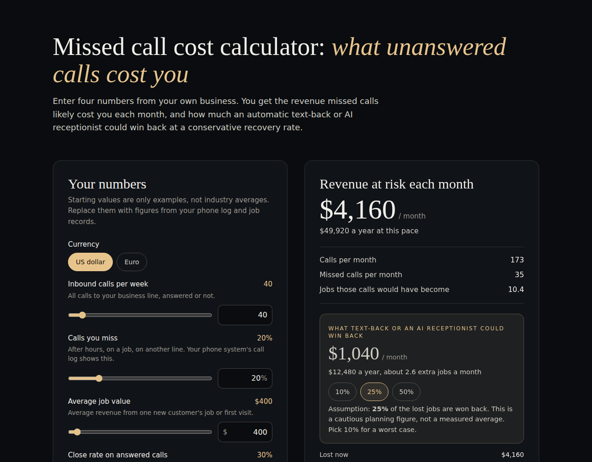

# Missed Call Cost Calculator

A single-file, dependency-free calculator that estimates how much revenue a business loses to unanswered phone calls, and how much an automatic text-back or AI receptionist could plausibly win back.



**Live version:** [vlstudio.app/tools/missed-call-calculator](https://vlstudio.app/tools/missed-call-calculator/)

## What it does

You enter four numbers from your own business:

- inbound calls per week
- % of calls you miss
- average job value
- close rate on answered calls

It shows revenue at risk per month and per year, and a "won back" figure at a recovery rate you choose (10%, 25% or 50%). USD and EUR are supported.

## The math

```
Missed calls per month = calls per week × 4.33 × % missed
Revenue at risk        = missed calls × close rate × average job value
Won back               = revenue at risk × recovery assumption
```

4.33 is the average number of weeks in a month (52 ÷ 12). The result is an upper bound on revenue (not profit) from first jobs only. The default 25% recovery rate is a cautious planning figure, not a measured benchmark.

## Use it

- Open `index.html` in any browser. No build step, no dependencies, no tracking.
- Embed it: copy the file into your site, or drop it into an `<iframe>`.
- Everything runs client-side. Nothing you type is stored or sent anywhere.

## License

MIT. See [LICENSE](LICENSE). Built by [VL Studio](https://vlstudio.app).
